# Chess Timer · AWTRIX NG

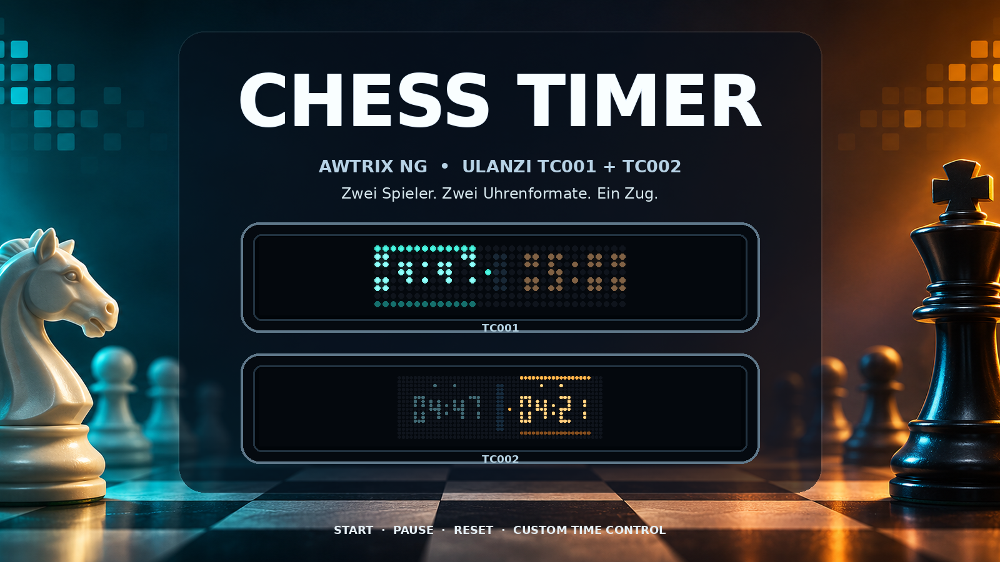

[](https://buymeacoffee.com/q14six)

**Version:** `20261118.214215` · **Ulanzi TC001:** 32 × 8 LED · **Ulanzi TC002:** 52 × 16 LED · **License:** MIT

## Deutsch

Eine vollwertige **Schachuhr für zwei Spieler**, die direkt auf einer Ulanzi TC001 oder TC002 mit AWTRIX NG läuft. Der Countdown wird lokal auf der Uhr ausgeführt. Beide Modelle nutzen eigene Berry-Skripte mit angepasstem LED-Layout und physischer Tastenbedienung.

### Installation direkt über GitHub

### [▶ HTML-Installer starten](https://q14six.github.io/ChessTimer/)

Der vierseitige Installationsassistent läuft über **GitHub Pages** – ohne Download, Python oder zusätzliche Software. Auf der ersten Seite werden die Uhren ausgewählt, anschließend die Bedenkzeiten eingestellt und die passenden Skripte direkt von GitHub geladen und installiert.

> **Wichtig für die Erstveröffentlichung:** Repository **`Q14siX/ChessTimer`** mit Standardbranch **`main`** anlegen und den **Inhalt** dieses `GitHub`-Ordners in das Stammverzeichnis des Repositories hochladen. Einmalig unter **Settings → Pages → Build and deployment → Source: GitHub Actions** auswählen. Der enthaltene Workflow `.github/workflows/pages.yml` veröffentlicht danach den Installer unter **https://q14six.github.io/ChessTimer/**. Der Link funktioniert erst nach der ersten erfolgreichen Pages-Bereitstellung.

### Funktionen

- Zwei unabhängig herunterzählende Spielerzeiten, wobei nur die aktive Zeit läuft.
- **Individuelle Bedenkzeiten** pro Spieler von `00:01` bis `99:59` (Minuten und Sekunden).
- Schnellauswahl von **1, 3, 5, 10, 15, 30 und 60 Minuten** im Installer.
- **Zeitlimit nachträglich ändern**, ohne das Skript erneut zu installieren: direkt im Installer oder in der AWTRIX-NG-Weboberfläche unter **Apps → Chess Timer → Einstellungen**.
- Start, Pause, Fortsetzen, Zugwechsel und Reset über die Tasten der Uhr.
- Unterschiedliche, auf die Displays abgestimmte LED-Anzeigen für TC001 und TC002, einschließlich aktive Spielerzeit, Pausenstatus und roter Zeitablaufanzeige.
- Zusätzliche **Drehknopf-Bedienung auf TC002**.
- Eigenständige **On-Demand-App**: die Schachuhr läuft außerhalb der normalen App-Rotation.
- Keine Cloud, kein permanenter PC, keine Home-Assistant-Instanz und keine Internetverbindung während der Partie.

### Tastenbedienung

| Eingabe | Funktion |
| --- | --- |
| **Links kurz** | Spieler 1 beendet seinen Zug; die Zeit von Spieler 2 läuft. |
| **Rechts kurz** | Spieler 2 beendet seinen Zug; die Zeit von Spieler 1 läuft. |
| **Mitte kurz** | Countdown starten, pausieren oder fortsetzen. |
| **Links lang** | Reset, wenn die Uhr nicht läuft. |
| **Rechts lang** | Zeitvorgabe durchschalten, wenn die Uhr nicht läuft. |
| **Mitte lang** | Schachuhr verlassen bzw. AWTRIX-Uhrenmenü öffnen. |

**TC002 zusätzlich:** Drehknopf kurz drücken = Start/Pause; im Stopp/Pausenmodus drehen = Zeitvorgabe wechseln; Drehknopf lang drücken = Reset. Über die Zeitvorgabenauswahl lässt sich nach den Presets auch wieder die dauerhaft in der Weboberfläche gespeicherte Zeit einstellen.

### Vorschau – TC001 (32 × 8)

| Startbereit | Spieler 1 am Zug | Spieler 2 am Zug |
| :---: | :---: | :---: |
| 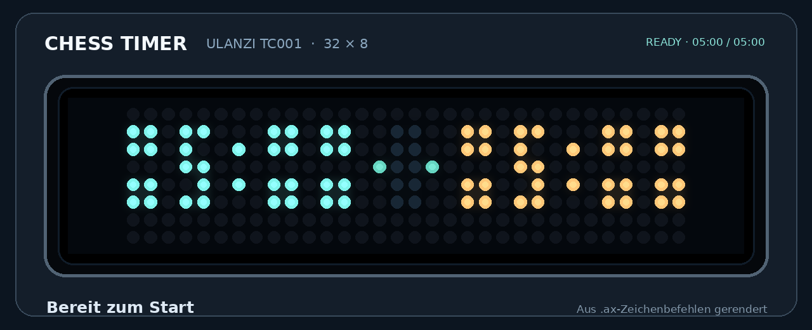 | 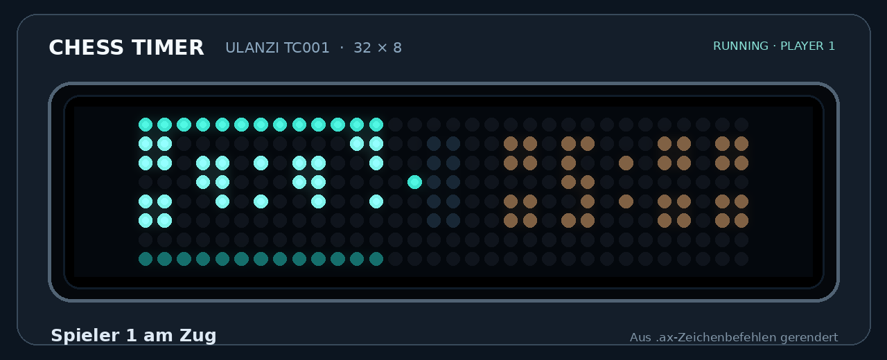 | 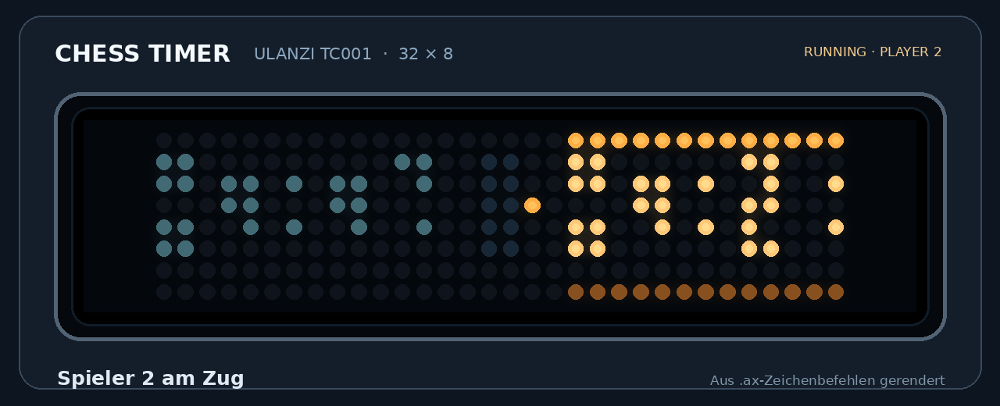 |

| Pausiert | Zeit abgelaufen |
| :---: | :---: |
| 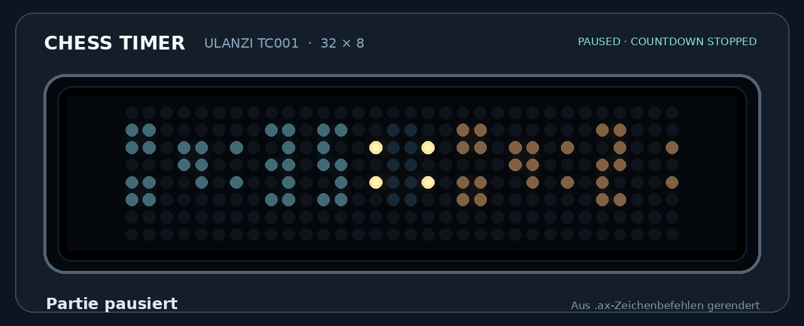 | 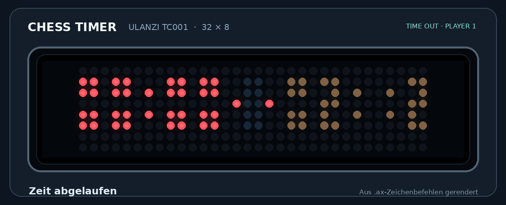 |

### Vorschau – TC002 (52 × 16)

| Startbereit | Spieler 1 am Zug | Spieler 2 am Zug |
| :---: | :---: | :---: |
| 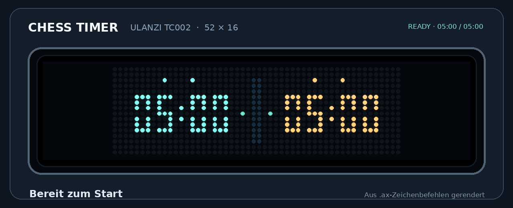 | 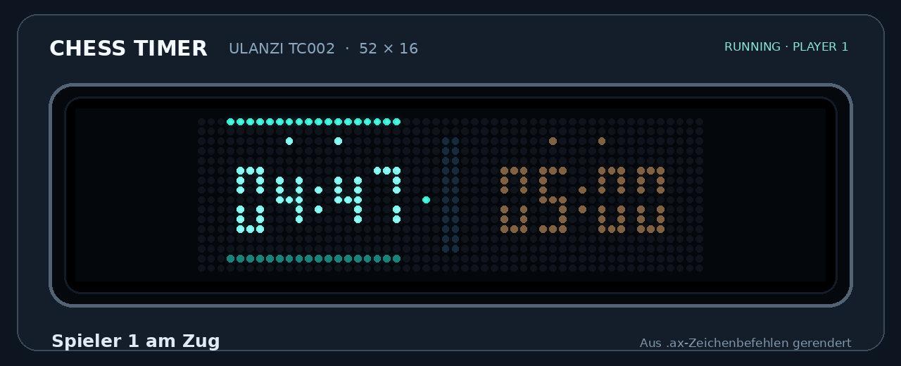 | 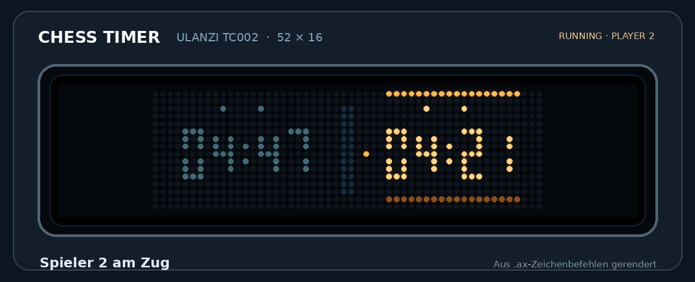 |

| Pausiert | Zeit abgelaufen |
| :---: | :---: |
| 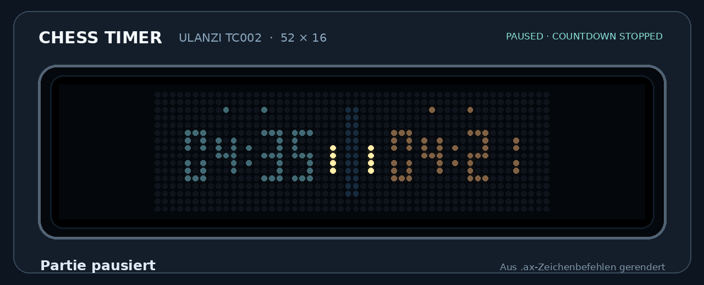 | 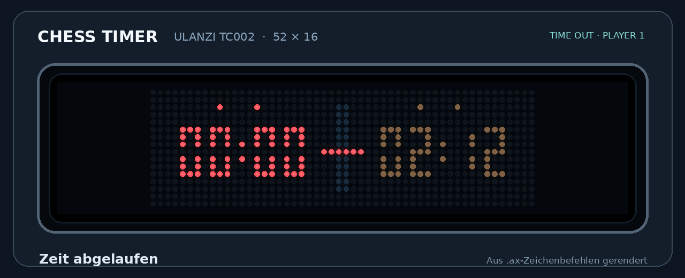 |

*Die Vorschaubilder wurden aus den LED-Zeichenbefehlen und Segmentdefinitionen der jeweiligen `.ax`-Skripte gerendert; sie sind keine Fotos einer physischen Uhr.*

### Zeitlimit und Installation

1. Den [Installer](https://q14six.github.io/ChessTimer/) öffnen und auf **Seite 1** die Uhr(en) per IP-Adresse oder Netzwerksuche verbinden und auswählen. Optional Zugangsdaten für die Webanmeldung an der Uhr eingeben.
2. Auf **Seite 2** Minuten und Sekunden pro Spieler festlegen oder eine Zeitvorgabe auswählen.
3. Auf **Seite 3** die Installation starten. Der Installer lädt je Modell ausschließlich das passende Skript über die unten genannten **festen GitHub-Raw-Adressen**, überträgt es mit der AWTRIX-NG-HTTP-API und speichert die gewählten Zeiten.
4. Auf **Seite 4** den Gerätestatus prüfen. Die Schachuhr lässt sich danach über das **Scripts-Menü** an der Uhr starten (langer Druck auf Mitte öffnet das Uhrenmenü).

**Später ändern:** Geräte erneut verbinden und **„Zeitlimit übertragen“** wählen. Die Uhr bestätigt die vier gespeicherten Werte. Das Ändern der App-Einstellungen startet das Skript neu und **setzt eine laufende Partie zurück**. Die auf der Uhr gewählten Presets gelten nur bis zum Skriptneustart bzw. bis zur nächsten Webkonfiguration.

**Wichtig – Browserfreigabe:** Bei einer GitHub-Pages-Seite (`https://`) und einer lokalen AWTRIX-Uhr (`http://`) benötigt Chrome unter Umständen die Berechtigung **„Zugriff auf Geräte im lokalen Netzwerk“**. Diese beim angeforderten Dialog erlauben. Einige Browser blockieren solche Zugriffe grundsätzlich. Als Alternative im Installer **„Ohne Verbindung fortfahren“ → „Manuelles Skript“** auswählen und die Datei in der AWTRIX-Weboberfläche unter **Scripts** importieren. Die `.ax`-Quelldateien liegen außerdem direkt in `clocks/`.

### Feste GitHub-Raw-Adressen

- **Titelbild:** [`media/title.png`](https://raw.githubusercontent.com/Q14siX/ChessTimer/main/media/title.png)
- **TC001:** [`clocks/TC001.ax`](https://raw.githubusercontent.com/Q14siX/ChessTimer/main/clocks/TC001.ax)
- **TC002:** [`clocks/TC002.ax`](https://raw.githubusercontent.com/Q14siX/ChessTimer/main/clocks/TC002.ax)

Diese drei URLs sind **im `index.html` fest einprogrammiert**. Für Installation und manuellen `.ax`-Export benötigt der Installer deshalb eine Internetverbindung. Nach Installation läuft die Schachuhr ohne Internet weiter. Repository-Name, GitHub-Konto und `main`-Branch dürfen nicht abweichen, ohne die fest hinterlegten URLs ebenfalls anzupassen.

### Repository-Inhalt

```text
ChessTimer/
├── index.html                  HTML-Installationsassistent / GitHub Pages
├── README.md                   Dokumentation Deutsch / Englisch
├── RELEASE.md                  Erstveröffentlichung Deutsch / Englisch
├── LICENSE                     MIT-Lizenz
├── .nojekyll
├── .github/workflows/
│   └── pages.yml               Automatisches GitHub-Pages-Deployment
├── clocks/
│   ├── TC001.ax                Berry-App für 32 × 8
│   └── TC002.ax                Berry-App für 52 × 16
└── media/
    ├── title.png               Titelbild
    ├── TC001/                  Fünf aus dem Skript gerenderte Vorschauen
    └── TC002/                  Fünf aus dem Skript gerenderte Vorschauen
```

### Voraussetzungen

- **AWTRIX NG** mit aktivierter Berry-Skriptfunktion (nicht die Original-Ulanzi-Firmware oder AWTRIX 3).
- Ulanzi TC001 (32 × 8) oder TC002 (52 × 16), beziehungsweise kompatible AWTRIX-NG-Displays mit diesen Auflösungen.
- Internetverbindung im Browser für die GitHub-Raw-Dateien; Verbindung im lokalen Netz für die automatische Installation.
- **Nicht enthalten:** Fischer-/Bronstein-Inkrement, Partienspeicherung oder Weiterlaufen nach Stromausfall.

Referenzen: [AWTRIX NG Scripting](https://blueforcer.github.io/awtrix-ng/tc002/guides/scripting/) · [Skriptkonfiguration](https://blueforcer.github.io/awtrix-ng/tc002/guides/scripting/storage/) · [HTTP API](https://blueforcer.github.io/awtrix-ng/tc002/reference/http/)

---

## English

**Chess Timer** is a self-contained two-player chess clock for **AWTRIX NG** on the Ulanzi **TC001 (32 × 8)** and **TC002 (52 × 16)**. The countdown runs on the clock itself; no computer, cloud, Home Assistant, or server is needed during a game.

### Install directly from GitHub

### [▶ Launch the HTML installer](https://q14six.github.io/ChessTimer/)

The four-step setup wizard is hosted on GitHub Pages. It discovers or connects to one or more clocks, lets you configure each player's starting time, downloads the correct Berry script from **GitHub Raw**, and installs it through the AWTRIX NG HTTP API.

**For first-time publication:** Create a public repository named **`Q14siX/ChessTimer`** with default branch `main`, upload the contents of this `GitHub` folder to its root, and select **Settings → Pages → Build and deployment → Source: GitHub Actions**. The included workflow publishes the installer to **https://q14six.github.io/ChessTimer/** after a successful first deployment. The link is not live until GitHub Pages has been enabled and deployed.

### Key features

- Two independent countdowns; only the current player's time runs.
- Independently configurable **00:01–99:59** time limits per player, in minutes and seconds.
- Presets: 1, 3, 5, 10, 15, 30, and 60 minutes.
- **Change time limits later** from the installer or the AWTRIX NG app-settings screen, without re-uploading the script.
- Physical buttons: start, pause, resume, end turn, and reset.
- Dedicated layouts for 32 × 8 and 52 × 16 pixels, with active-turn indicators, pause status and red timeout state.
- TC002 rotary knob support.
- `@ondemand`: launched manually from the clock's **Scripts** menu; not part of the normal app rotation.

### Physical controls

| Input | Action |
| --- | --- |
| **Left short press** | End player 1's turn; player 2's clock runs. |
| **Right short press** | End player 2's turn; player 1's clock runs. |
| **Middle short press** | Start, pause, or resume. |
| **Left long press** | Reset (only while stopped/paused). |
| **Right long press** | Cycle time presets (only while stopped/paused). |
| **Middle long press** | Exit to the AWTRIX device menu. |

**TC002:** Press the knob to toggle start/pause; rotate it to change presets while stopped; hold to reset while stopped. The preset cycle also returns to the saved web-configured time limit.

### Preview gallery

| TC001 · 32 × 8 | TC002 · 52 × 16 |
| :---: | :---: |
|  |  |
|  |  |
|  |  |

*These previews are renders of the actual drawing commands and segment definitions in each `.ax` script, not photographs of physical clocks.*

### How to install

1. [Launch the installer](https://q14six.github.io/ChessTimer/) and select the clocks on page 1 (manual IP or LAN scan; web-login credentials if required).
2. Enter the players' time limits on page 2.
3. Install on page 3. The wizard retrieves the matching source from `clocks/TC001.ax` or `clocks/TC002.ax` using the **hard-coded raw.githubusercontent.com URLs**, installs it and verifies the saved settings.
4. Review the results on page 4. Start **ChessTimer** from the clock's **Scripts** device menu.

**Changing time controls later:** Reconnect a clock and choose **„Zeitlimit übertragen“** (Apply time limit) on page 2, or adjust the four values in **Apps → Chess Timer → Settings** on the AWTRIX web UI. This restarts the script and **resets any in-progress game**.

**Local-network browser limitations:** A secure GitHub Pages site connecting to an HTTP clock may trigger Chrome's **Local network access** permission prompt. Grant access if offered. Some browsers block cross-origin or mixed-content requests entirely. Use the wizard's manual-script option or import `clocks/TC001.ax` / `clocks/TC002.ax` directly in the clock's Scripts UI instead. The installer requires online access to GitHub Raw even when launched as a downloaded HTML file.

### Pinned RAW assets

- [Cover image](https://raw.githubusercontent.com/Q14siX/ChessTimer/main/media/title.png)
- [TC001 Berry source](https://raw.githubusercontent.com/Q14siX/ChessTimer/main/clocks/TC001.ax)
- [TC002 Berry source](https://raw.githubusercontent.com/Q14siX/ChessTimer/main/clocks/TC002.ax)

Repository owner, name and branch (`Q14siX/ChessTimer`, `main`) are embedded in `index.html`; update the links if you rename the repository. The timer works offline once installed, but the web installer must fetch the scripts from GitHub.

### Requirements and limitations

AWTRIX NG with Berry enabled and a compatible 32 × 8 / 52 × 16 display. Stock Ulanzi firmware and AWTRIX 3 are not supported. No chess increment, game persistence or power-loss recovery in this release.

**License:** MIT · **Author:** Q14siX · **Version:** `20261118.214215`

[](https://buymeacoffee.com/q14six)
