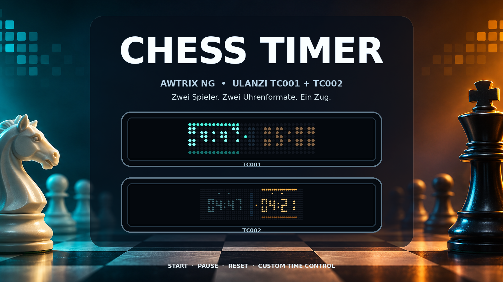

# Chess Timer — First Public Release / Erstveröffentlichung

**Version:** `20261118.214215` · **Date / Datum:** 18.11.2026 · **Platforms / Geräte:** Ulanzi TC001 & TC002 · **License:** MIT

## Deutsch

### [▶ Web-Installer direkt auf GitHub öffnen](https://q14six.github.io/ChessTimer/)

**Erstveröffentlichung** der AWTRIX-NG-Schachuhr **Chess Timer**. Beide Spieler erhalten einen eigenen Countdown. Die Spielzeit kann vollständig über die physischen Tasten der Uhr gesteuert werden. Der Installer übernimmt die Installation auf einer oder mehreren Uhren, erkennt die LED-Auflösung und überträgt die dazu passende `.ax`-Datei.

**Umfang der Erstveröffentlichung**

- **TC001:** Eigenständiges 32 × 8-Berry-Skript mit kompakter Zweispieleranzeige.
- **TC002:** Eigenständiges 52 × 16-Berry-Skript mit größerer Anzeige und Unterstützung des Drehknopfs.
- **Zeitkontrolle:** Frei konfigurierbare Minuten und Sekunden von `00:01` bis `99:59` für jeden Spieler, gemeinsame Bedenkzeit oder getrennte Zeitlimits.
- **Tasten:** Start, Pause, Fortsetzen, Spielerwechsel, Reset und Auswahl von Zeitvorgaben.
- **Statusanzeigen:** Startbereit, aktive Spielerzeit, pausierte Partie und rot markierter Zeitablauf.
- **Installer:** Responsiver mehrseitiger HTML-Assistent mit Geräteerkennung, Passwortunterstützung, Mehrfachauswahl und nachträglicher Zeitkonfiguration.
- **GitHub-Sources:** Skripte unter `clocks/TC001.ax` und `clocks/TC002.ax` sowie das Titelbild unter `media/title.png` werden über fest hinterlegte GitHub-Raw-URLs geladen.
- **Medien:** Ein Titelbild und je fünf aus den Zeichnungsanweisungen der Uhrenskripte gerenderte Ansichten.
- **Veröffentlichung:** GitHub-Pages-Workflow und direkter Installer-Link in README und RELEASE.

**Hinweise:** Eine Änderung der Zeitkontrolle setzt die Partie zurück. Der Installer benötigt Zugriff auf GitHub Raw; die Uhr selbst benötigt während des Spiels keine Internetverbindung. Für die direkte Verbindung mit lokalen HTTP-Uhren kann im Browser eine Netzwerkfreigabe erforderlich sein. Die Erstveröffentlichung enthält noch kein Schach-Inkrement und keine Wiederherstellung nach Stromausfall. Der Installer-Link wird erst nach der Einrichtung von GitHub Pages aktiv.

---

## English

### [▶ Launch the web installer on GitHub Pages](https://q14six.github.io/ChessTimer/)

This is the **first public release** of **Chess Timer** for AWTRIX NG. It provides two independent countdowns controlled entirely by the physical clock buttons. Separate Berry apps are provided for the two Ulanzi matrix sizes.

**Included in this initial release**

- **TC001:** Custom 32 × 8 pixel script and compact dual-player countdown display.
- **TC002:** Dedicated 52 × 16 pixel script with larger layout and rotary-knob input.
- **Time controls:** Individual player times between `00:01` and `99:59` in minutes and seconds, plus preset shortcuts.
- **Hardware controls:** Start, pause, resume, change active player, reset, and quick time selection.
- **States:** Ready, player 1 running, player 2 running, pause, and red timeout indication.
- **Installation:** Responsive four-step HTML setup wizard supporting multiple devices, device detection, authenticated clocks and subsequent adjustment of time limits.
- **GitHub delivery:** Hard-coded raw GitHub asset URLs for `clocks/TC001.ax`, `clocks/TC002.ax`, and `media/title.png`.
- **Previews:** One cover illustration plus five script-derived LED previews per clock model.
- **Publishing:** Automatic GitHub Pages workflow with a direct installer link in both Markdown documents.

**Notes:** Changing a time control resets the current match. The browser installer requires access to GitHub Raw, but the installed timer operates locally without the Internet. Browsers may require LAN access permission. No incremental time control or power-loss recovery is included in this initial release. The installer URL becomes functional after GitHub Pages is enabled and deployed.
